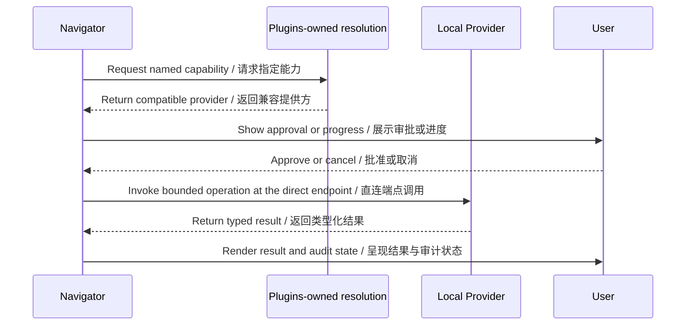

# Tool and capability system / 工具与能力系统

## Current posture / 当前状态

Navigator V1 does not contain a local capability resolver or local provider
implementations. Product calls are implemented as direct HTTP fan-out through
`ProductReadPort`; capability IDs, payload schemas, SDKs, and TCKs are owned by
their Product or Plugin repositories and are not declared here.

Navigator V1 不包含本地能力解析器或本地提供方实现。产品调用已实现为经
`ProductReadPort` 的直连 HTTP fan-out；能力 ID、载荷 schema、SDK 与 TCK 由其所属
Product 或 Plugin 仓库拥有，不在本仓库声明。

## Capability seams / 能力接缝

Status values reflect the Plugins canonical index at the audited SHA. None of
these seams is connected by Navigator V1; a seam may only be consumed after its
owner contract is accepted.

下表状态来自审计 SHA 的 Plugins 规范索引。Navigator V1 均未接入这些接缝；只有在
owner contract 被接受后才能消费。

| Capability seam | Navigator-facing role / Navigator 侧职责 | Status |
|---|---|---|
| `skill.runtime.v1` | Reusable skill workflows for local agent use / 本地智能体使用的可复用技能工作流 | `MIGRATING` (no owner schema/SDK/TCK/entrypoint) |
| `tool.provider.v1` | Approved local tools, including MCP-backed tools / 获批本地工具，包括基于 MCP 的工具 | `MIGRATING` (compatibility snapshot) |
| `mcp.server.v1` | MCP server tools / MCP 服务端工具 | `MIGRATING` (compatibility snapshot) |
| `memory.provider.v1` | User-approved workspace memory / 用户批准的工作区记忆 | Owner contract exists; not connected |
| `model.provider.v1` | Model calls used by local workflows / 本地工作流使用的模型调用 | Owner contract exists; not connected |
| `model.registry.v1` | Model metadata and version identity / 模型元数据与版本身份 | `NOT_DEFINED` |

## Exchange issue tools (Integration v1) / Exchange issue 工具（Integration v1）

Navigator exposes four fixed tools through the existing DSH ToolRuntime:
`exchange_issue_query`, `exchange_issue_comment`, `exchange_issue_state_update`,
and `exchange_operation_read`. These are typed calls to the Exchange Product
REST contract, not a generic HTTP or shell tool and not a second integration
state store.

The host configures one Exchange API origin and Workspace. Each request obtains
the active session's first-party user Bearer through a host-owned provider and
sends the Workspace scope header. Exchange verifies that credential through
Platform and checks its exact operation grant. The model cannot supply identity
fields, account refs, delegation refs, endpoints, or execution credentials.
General cloud runtimes must inject a per-session provider; there is no process
environment fallback. The local single-user launcher can opt in only for one
explicit `CYRENE_EXCHANGE_INTEGRATION_SESSION_ID`, matched on every call and
bound by the launcher to its configured Workspace. The first-party session
Control Bridge remains `NOT_RUN`.

Issue query posts an idempotent read intent, polls its operation for at most
three seconds, then reads Exchange's cached issue projection only after a
`SUCCEEDED` result. It returns the operation reference without issue data when
authorization is pending, polling times out, or the snapshot is unavailable.
Comment and state changes wait for Navigator's existing human approval before
posting a typed request with `Idempotency-Key`; a 202 response means queued and
includes Exchange's operation `Location`. Exchange independently rechecks
Platform authorization and delegation before its registered connector runs.
Operation status remains Exchange-owned and is read through the dedicated tool.
Account and delegation association is configured through the non-AI management
surface. Navigator CI checks the five consumer routes, request/response DTOs,
state domains, and 202 `Location` against the owner-generated fixture pinned in
[`harness/contracts/exchange-integration-v1.lock.json`](../../harness/contracts/exchange-integration-v1.lock.json).

Navigator 通过现有 DSH ToolRuntime 暴露四个固定工具：`exchange_issue_query`、
`exchange_issue_comment`、`exchange_issue_state_update` 和 `exchange_operation_read`。
它们调用 Exchange Product REST 契约，不是通用 HTTP 或 shell 工具，也不会建立第二套集成状态库。

宿主配置一个 Exchange API origin 和 Workspace。每次请求都通过宿主管理的 provider 获取当前
Session 的 first-party user Bearer，并发送 Workspace 范围标头。Exchange 通过 Platform 验证凭据
并检查精确操作授权。模型不能提供身份字段、账号引用、delegation 引用、端点或执行凭据。
通用云运行环境必须注入逐 Session provider，没有进程环境令牌回退。本地单用户 launcher 仅可
绑定一个显式的 `CYRENE_EXCHANGE_INTEGRATION_SESSION_ID`，并会在每次调用时匹配，同时绑定到
已配置 Workspace。first-party session Control Bridge 状态仍是 `NOT_RUN`。

Issue 查询会提交带幂等键的只读意图，最多轮询三秒，且只在 Exchange 返回 `SUCCEEDED` 后读取其
缓存 issue projection。授权仍在等待、轮询超时或缓存不可用时，只返回 operation 引用，不声称已
取得 issue 数据。评论和状态变更先等待 Navigator 现有人工审批，再提交类型化请求和
`Idempotency-Key`；HTTP 202 表示已排队，并附有 Exchange operation `Location`。Exchange 会在注册
的 Connector 执行前独立重新检查 Platform 授权与 delegation。Operation 状态由 Exchange 保存并通过
专用工具读取。账号与 delegation 关联通过非 AI 管理界面配置。
Navigator CI 会依据
[`harness/contracts/exchange-integration-v1.lock.json`](../../harness/contracts/exchange-integration-v1.lock.json)
中固定的 owner fixture，校验五个消费者路由、请求/响应 DTO、状态域及 202 `Location`。

Capability providers own their operation; Navigator owns user intent,
presentation, and client-side coordination.

能力提供方负责自身操作；Navigator 负责用户意图、呈现与客户端协调。

## Intended resolution sequence / 预期解析时序（V1 未接入）

## Non-ownership rules / 非归属规则

- Navigator must not bypass the Plugins-owned capability contract when local tool
  integration is connected.
- A local provider must not silently become the authority for workspace or product state.
- Approval, cancellation, and progress must remain visible at the client boundary.
- Remote Product connectors preserve each Product's API and error boundaries and
  never assume a Platform capability payload API.
- Capability integration must wait for an accepted owner contract; no capability
  ID or payload may be invented in this repository.

- 接入本地工具时，Navigator 不得绕过 Plugins-owned 能力契约。
- 本地提供方不能静默成为工作区或产品状态的权威。
- 审批、取消与进度必须在客户端边界可见。
- 远程产品连接器保留各产品的 API 与错误边界，且不得假设 Platform capability payload API。
- 能力接入必须等待 owner contract 被接受；不得在本仓库发明 capability ID 或载荷。
